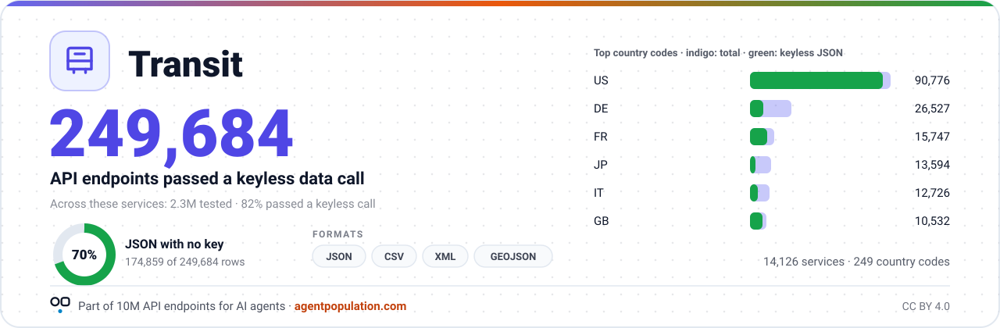
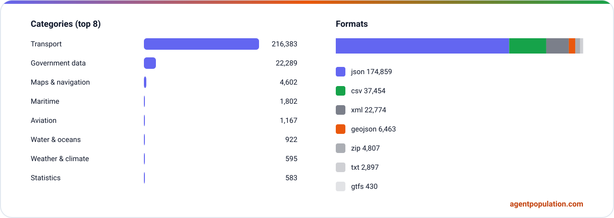

<p align="center"></p>

# 🚆 Transit API endpoints

**249,684 transit API endpoints that answered a keyless GET with a data body. For agent and app builders.**

<p align="center"><a href="#files"></a> <a href="#columns-and-tags"></a> <a href="#whats-inside"></a> <a href="#whats-inside"></a> <a href="LICENSE"></a></p>

<p align="center"><a href="#whats-in-it-for-you">What's in it</a> · <a href="#for-ai-agents">For AI agents</a> · <a href="#quick-start">Quick start</a> · <a href="#test-it-yourself">Test it yourself</a> · <a href="#files">Files</a> · <a href="#licence-and-credit">Licence</a> · <a href="#part-of-10m-api-endpoints-for-ai-agents">More packs</a></p>

This repository holds a 1,000-row sample and the services list; the full list of 249,684 endpoints is one download from the [latest release](https://github.com/agentpopulation/240k-transit-apis-for-agents/releases/latest).

**Endpoints for building a transport agent or app.** Bike-share and scooter feeds (GBFS), timetables (GTFS), traffic counts, road weather, parking and stop layers, as URLs that answered with no key on their test date.

Selection rule: rows where `tags has transit OR tags has gtfs OR tags has gbfs OR tags has bike-share OR tags has traffic OR tags has parking`, less the rows that a leave-out rule drops (each counted under Known limits).

85,574 of these 249,684 rows match the focus rule (below); the others are in the pack by the selection rule only, and Known limits says what they are. 63,909 rows (25.6%) are map layers on ArcGIS Online, where anyone can publish.

## In plain words

**What is an API endpoint?** An API endpoint is one web address that a program can ask for data, for example the latest reading at one weather station. A single service, such as a national weather agency, can have thousands of endpoints: one per station, city or dataset. This pack counts endpoints, not separate services.

**What does "passed a data call" mean?** On the date shown in each row, AgentPopulation sent one plain request to that address, with no password or key, and got a non-empty data body back (JSON, CSV, XML or a file): not an error page and not an empty result. Some bodies describe a dataset rather than hold its values; see Known limits. It shows the address answered with data on that day. It is not a promise that it answers today, and licences and usage limits were not reviewed.

## What's in it for you

Four ways to use this pack. Each bucket gives a count, a filter you can apply to the CSV, one example that passed, and a list of recommended starting points with the rule that picked them. Buckets overlap; a row can fit more than one.

Examples, recommended lists and the preview are drawn from rows that match this pack's focus rule, so a row that a tag put in this pack but that is about something else is not shown as a starting point. Counts cover the whole bucket.

<details>
<summary>The focus rule</summary>

Focus rule: `category in ("Transport & Mobility", "Navigation & Geo/Maps") AND NOT title matches /trafficking/i AND title matches /\b(bus|buses|rail|railway|train|trains|tram|metro|subway|transit|bike|bikes|bicycle|cycle|cycling|scooter|scooters|gbfs|gtfs|parking|car park|traffic|road|roads|stop|stops|route|routes|transport|mobility|ferry|line|lines|velo|vélo|verkehr|bahn|trafic|stationnement|réseau|sharing|journey|station_status|station_information|system_information)\b/i`

</details>

### 🤖 Agent tools: GBFS bike and scooter feeds

**16,074** endpoints from 265 services · Wrap a GBFS station_status URL as a get_bike_availability tool: pass the system and station, return bikes and docks.

3,257 of these are availability feeds (`station_status`, `free_bike_status` or `vehicle_status`); the others are feeds such as system information, vehicle types and pricing plans.

Start with: `tags has agent-ready AND (tags has gbfs OR tags has bike-share)`

Example: [GBFS station\_status: biciArteixo (Artexio, ES)](https://gbfs.nextbike.net/maps/gbfs/v2/nextbike_aa/en/station_status.json) · Nextbike · passed 2026-11-14

<details>
<summary>Recommended starting points: 8 services, picked by the stated criteria inside</summary>

**Recommended starting points.** Selected by stated criteria, not a ranking of quality: Services in this pack with the most endpoints that match this bucket and are tagged `agent-ready` (no key sent in the test call, JSON body, passed a data call). Ties go to the service with more country codes, then by name. Only services with at least one bucket row that matches the focus rule are listed, and the sample comes from those rows; the counts cover the whole bucket. The sample URL is the first row by URL sort after preferring, in this order: rows that match the bucket's sample preference when it has one, rows that return values rather than describe a dataset or a service (not ERDDAP /info/ pages, OGC GetCapabilities requests, bare OWS addresses, PxWeb tables, UN SDG series lists, Statistics Canada download pointers, WorldPop listings, GTFS validation reports, untitled rows or service root addresses), and agent-ready rows. Sample preference in this bucket: `url contains "station_status"`. Services named "ArcGIS organization" hold map layers from many owners and are added only when fewer than 5 other services match.

| Service (host) | Endpoints in bucket | In pack | Country codes in bucket | Formats in bucket | Sample URL that passed |
|---|---:|---:|---|---|---|
| Nextbike (gbfs.nextbike.net) | 2,376 | 2,662 | 21 codes | json | [GBFS station\_status: biciArteixo (Artex…](https://gbfs.nextbike.net/maps/gbfs/v2/nextbike_aa/en/station_status.json) (2026-11-14) |
| Donkey (stables.donkey.bike) | 1,736 | 1,736 | 13 codes | json | [Donkey Republic Augsburg: GBFS station\_…](https://stables.donkey.bike/api/public/gbfs/2/Augsburg/de/station_status.json) (2026-11-15) |
| Bird (mds.bird.co) | 1,224 | 1,237 | 12 codes | json | [GBFS station\_status: Bird Adeje (Adeje)](https://mds.bird.co/gbfs/v2/public/adeje/station_status.json) (2026-11-14) |
| api.mobidata-bw.de | 1,049 | 1,123 | CH, DE, LI | json | [MobiData BW sharing: GBFS station\_statu…](https://api.mobidata-bw.de/sharing/gbfs/v2/bird-chalonsenchampagne/station_status) (2026-11-15) |
| Citybik (api.citybik.es) | 813 | 813 | 52 codes | json | [CityBikes: All bike-share networks](https://api.citybik.es/v2/networks) (2026-11-15) |
| Getaround (getaround.com) | 718 | 718 | 6 codes | json | [GBFS system\_information: Getaround Aals…](https://getaround.com/gbfs/v3/aalst/system_information) (2026-11-14) |
| Fifteen (gbfs.partners.fifteen.eu) | 458 | 503 | DE, ES, FR | json | [GBFS station\_status: Vélo Modalis Angou…](https://gbfs.partners.fifteen.eu/gbfs/2.2/angouleme/en/station_status.json) (2026-11-14) |
| Lyft (gbfs.lyft.com) | 447 | 447 | US | json | [Motivate LLC: GBFS station\_status \[en\]:…](https://gbfs.lyft.com/gbfs/1.1/bay/en/station_status.json) (2026-11-15) |

</details>

### 📱 App features: Parking and traffic maps

**30,018** endpoints from 4,175 services · Show nearby parking and traffic counts on a map card.

Start with: `(tags has parking OR tags has traffic) AND category is "Transport & Mobility" AND NOT title matches /trafficking/i`

Example: [Finnish rail live trains: Ähtäri](https://rata.digitraffic.fi/api/v1/live-trains/station/%C3%84HT?arrived_trains=0&arriving_trains=10&departed_trains=0&departing_trains=10) · Digitraffic · passed 2026-11-14

<details>
<summary>Recommended starting points: 8 services, picked by the stated criteria inside</summary>

**Recommended starting points.** Selected by stated criteria, not a ranking of quality: Services in this pack with the most endpoints that match this bucket and passed a data call. Ties go to the service with more country codes, then by name. Only services with at least one bucket row that matches the focus rule are listed, and the sample comes from those rows; the counts cover the whole bucket. The sample URL is the first row by URL sort after preferring, in this order: rows that match the bucket's sample preference when it has one, rows that return values rather than describe a dataset or a service (not ERDDAP /info/ pages, OGC GetCapabilities requests, bare OWS addresses, PxWeb tables, UN SDG series lists, Statistics Canada download pointers, WorldPop listings, GTFS validation reports, untitled rows or service root addresses), and agent-ready rows. Services named "ArcGIS organization" hold map layers from many owners and are added only when fewer than 5 other services match.

| Service (host) | Endpoints in bucket | In pack | Country codes in bucket | Formats in bucket | Sample URL that passed |
|---|---:|---:|---|---|---|
| Transparenzportal Hamburg (archiv.transparenz.hamburg.de) | 1,259 | 2,081 | DE | xml, json, csv, zip, txt | [Traffic Lights Data Hamburg](https://archiv.transparenz.hamburg.de/hmbtgarchive/HMDK/datastreams_255693_snap_27.JSON) (2026-11-15) |
| Digitraffic (rata.digitraffic.fi) | 1,181 | 1,181 | FI, SE | json | [Finnish rail live trains: Ähtäri](https://rata.digitraffic.fi/api/v1/live-trains/station/%C3%84HT?arrived_trains=0&arriving_trains=10&departed_trains=0&departing_trains=10) (2026-11-14) |
| region.statistik-nord.de | 1,036 | 1,054 | DE | txt, csv | [Settlement and traffic areas by type of…](https://region.statistik-nord.de/detail_timelineexport/12/1101/31/1/341/) (2026-11-14) |
| Toscana (dati.toscana.it) | 947 | 998 | IT | csv, txt | [Region of Tuscany - SGCFIPILI - Station…](https://dati.toscana.it/dataset/0069ab3b-4c26-4d72-9c8e-358180567f23/resource/4fa6f353-42cc-4876-a363-2ad69b944950/download/sgc-fi-pi-li-a12-a11-livorno-ss1-uscita-direzione-firenze_110_2025.csv) (2026-11-15) |
| Villingen Schwenningen (apps.villingen-schwenningen.de) | 946 | 968 | DE | xml | [S - Village Building Line Plan / S\_B \_1…](https://apps.villingen-schwenningen.de/mapservervs/getcapbplan.php?map=S_B_1879.map&SERVICE=WMS&VERSION=1.3.0&REQUEST=GetCapabilities) (2026-11-14) |
| Hamburg (tld.iot.hamburg.de) | 832 | 836 | DE | json | [Freie und Hansestadt Hamburg traffic li…](https://tld.iot.hamburg.de/v1.1/Datastreams%2810%29/Observations?$top=10) (2026-11-15) |
| Destatis GENESIS (Germany) (genesis.destatis.de) | 662 | 1,240 | DE | txt, xml | [Settlement and traffic area: Germany, c…](https://genesis.destatis.de/genesisWS/downloads/00/tables/33111-0003_00.xml) (2026-11-14) |
| maps2.dcgis.dc.gov | 489 | 707 | US | json | [Parking Blockface](https://maps2.dcgis.dc.gov/DCGIS/rest/services/DCGIS_DATA/Transportation_Parking_WebMercator/MapServer/0/query?where=1%3D1&outFields=*&returnGeometry=false&resultRecordCount=5&f=json) (2026-11-14) |

</details>

### 🧠 Grounding and data pipelines: GTFS feeds and CSV tables for scheduled loads

**38,416** endpoints from 1,352 services · Load GTFS timetables and CSV tables on a schedule into your own store.

1,148 of these carry the gtfs tag; the others are CSV tables.

Start with: `tags has gtfs OR format is csv`

Example: [Réseau urbain AggloBus - GTFS RT alerts Bourges A…](https://proxy.transport.data.gouv.fr/resource/agglobus-bourges-gtfs-rt-alerts) · proxy.transport.data.gouv.fr · passed 2026-11-14

<details>
<summary>Recommended starting points: 8 services, picked by the stated criteria inside</summary>

**Recommended starting points.** Selected by stated criteria, not a ranking of quality: Services in this pack with the most endpoints that match this bucket and passed a data call. Ties go to the service with more country codes, then by name. Only services with at least one bucket row that matches the focus rule are listed, and the sample comes from those rows; the counts cover the whole bucket. The sample URL is the first row by URL sort after preferring, in this order: rows that match the bucket's sample preference when it has one, rows that return values rather than describe a dataset or a service (not ERDDAP /info/ pages, OGC GetCapabilities requests, bare OWS addresses, PxWeb tables, UN SDG series lists, Statistics Canada download pointers, WorldPop listings, GTFS validation reports, untitled rows or service root addresses), and agent-ready rows. Sample preference in this bucket: `format is gtfs AND NOT url contains "action-report.json"`. Services named "ArcGIS organization" hold map layers from many owners and are added only when fewer than 5 other services match.

| Service (host) | Endpoints in bucket | In pack | Country codes in bucket | Formats in bucket | Sample URL that passed |
|---|---:|---:|---|---|---|
| Toscana (dati.toscana.it) | 991 | 998 | IT | csv | [Region of Tuscany - SGCFIPILI - Station…](https://dati.toscana.it/dataset/0069ab3b-4c26-4d72-9c8e-358180567f23/resource/4fa6f353-42cc-4876-a363-2ad69b944950/download/sgc-fi-pi-li-a12-a11-livorno-ss1-uscita-direzione-firenze_110_2025.csv) (2026-11-15) |
| Metropolegrenoble (data.metropolegrenoble.fr) | 928 | 973 | FR | csv | [Grenoble-Alpes Métropole: Arceaux à vél…](https://data.metropolegrenoble.fr/sites/default/files/dataset/2022/06/27/85c1dc61-04a0-4bf2-9042-ab54b945ab78/csv_gen_85c1dc61_04a0_4bf2_9042_ab54b945ab78_62b9ab80f3fd6.csv) (2026-11-15) |
| Nantesmetropole (data.nantesmetropole.fr) | 593 | 1,744 | FR | csv, json | [244400404\_ligne-covoiturage-covoitici-n…](https://data.nantesmetropole.fr/api/explore/v2.1/catalog/datasets/244400404_ligne-covoiturage-covoitici-nantes-metropole-gtfs/records?limit=1) (2026-11-12) |
| Eurostat dissemination API (ec.europa.eu) | 463 | 1,786 | EU | csv | [International extra-EU freight and mail…](https://ec.europa.eu/eurostat/api/dissemination/sdmx/2.1/data/avia_goexcc?format=SDMX-CSV&compressed=true) (2026-11-14) |
| Stadt Zürich Open Data (data.stadt-zuerich.ch) | 460 | 505 | CH | csv | [Trains from abroad to the place of arri…](https://data.stadt-zuerich.ch/dataset/bev_zuz_jahr_quartier_od3511/download/BEV351OD3511.csv) (2026-11-14) |
| Ireland Open Data Portal (ws.cso.ie) | 446 | 881 | IE | csv | [CEPHA29 - Total Commodities Conveyed by…](https://ws.cso.ie/public/api.restful/PxStat.Data.Cube_API.ReadDataset/CEPHA29/CSV/1.0/en) (2026-11-14) |
| Lombardia (www.dati.lombardia.it) | 430 | 1,967 | IT | csv, json | [Orario Ferroviario Regionale - Routes](https://www.dati.lombardia.it/resource/yqye-t4rp.json?$limit=1) (2026-11-15) |
| opendata.essen.de | 398 | 402 | DE | csv | [Cycling censuses](https://opendata.essen.de/sites/default/files/Radverkehrsz%C3%A4hlung%202023_3.csv) (2026-11-15) |

</details>

### 🧪 Evals and testing: Varied responses for tool-call tests

**249,684** endpoints · 14,126 services · 249 country codes · 7 formats · Run your tool calls against a fixed set of URLs across formats and record which answer; last_tested is the baseline for your own re-tests.

Start with: the whole pack

Example: [GBFS free\_bike\_status: biciArteixo (Artexio, ES)](https://gbfs.nextbike.net/maps/gbfs/v2/nextbike_aa/en/free_bike_status.json) · Nextbike · passed 2026-11-14

<details>
<summary>Recommended starting points: 8 services, picked by the stated criteria inside</summary>

**Recommended starting points.** Selected by stated criteria, not a ranking of quality: Services in this pack that returned the most different formats, then the most endpoints that passed a data call, then by name: a mix of response shapes to test parsers and tool calls. Only services with at least one bucket row that matches the focus rule are listed, and the sample comes from those rows; the counts cover the whole bucket. The sample URL is the first row by URL sort after preferring, in this order: rows that match the bucket's sample preference when it has one, rows that return values rather than describe a dataset or a service (not ERDDAP /info/ pages, OGC GetCapabilities requests, bare OWS addresses, PxWeb tables, UN SDG series lists, Statistics Canada download pointers, WorldPop listings, GTFS validation reports, untitled rows or service root addresses), and agent-ready rows. Services named "ArcGIS organization" hold map layers from many owners and are added only when fewer than 5 other services match.

| Service (host) | Endpoints in bucket | In pack | Country codes in bucket | Formats in bucket | Sample URL that passed |
|---|---:|---:|---|---|---|
| Портал відкритих даних (data.gov.ua) | 455 | 455 | UA | csv, json, zip, xml, txt, geojson | [Дані щодо ремонту автомобільних доріг м…](https://data.gov.ua/dataset/0731fd5d-3123-42fa-ac19-4008a25a40aa/resource/f3c07f9f-1d93-4098-926e-7efcce96bc86/download/roads-csv.json) (2026-11-15) |
| Dublinked Open Data for the Dublin Regio (data.smartdublin.ie) | 346 | 346 | IE | csv, json, geojson, xml, zip, txt | [Gritting Routes DLR](https://data.smartdublin.ie/dataset/0400ca4b-6f92-4884-a0b6-f1661d5613c3/resource/bb7532e7-e45b-49b4-97dc-7f59eb1c3177/download/gritting-routes-dlr.geojson) (2026-11-14) |
| Canadian Urban Data Catalogue (CUDC) (www.donneesquebec.ca) | 248 | 248 | CA | csv, xml, json, geojson, zip, txt | [Parking areas](https://www.donneesquebec.ca/recherche/dataset/099d789b-fd45-40ab-9a22-2f94a9500548/resource/7574e7f5-197c-4a95-b10c-b6da9b759bfa/download/stationnement.json) (2026-11-15) |
| Canadian Urban Data Catalogue (CUDC) (donnees.montreal.ca) | 102 | 102 | CA | csv, json, geojson, txt, xml, zip | [Traffic lights - locations all intersec…](https://donnees.montreal.ca/dataset/02ebdab9-cbf3-4f56-8c29-79fa0ed0ed2e/resource/af3fd28f-19ee-4c80-b8d9-29f17f18620d/download/feux-circulation.geojson) (2026-11-15) |
| Transparenzportal Hamburg (archiv.transparenz.hamburg.de) | 2,081 | 2,081 | DE | xml, json, zip, csv, txt | [Traffic Lights Data Hamburg](https://archiv.transparenz.hamburg.de/hmbtgarchive/HMDK/datastreams_255693_snap_27.JSON) (2026-11-15) |
| Toscana (dati.toscana.it) | 998 | 998 | IT | csv, xml, txt, geojson, zip | [Region of Tuscany - SGCFIPILI - Station…](https://dati.toscana.it/dataset/0069ab3b-4c26-4d72-9c8e-358180567f23/resource/4fa6f353-42cc-4876-a363-2ad69b944950/download/sgc-fi-pi-li-a12-a11-livorno-ss1-uscita-direzione-firenze_110_2025.csv) (2026-11-15) |
| Metropolegrenoble (data.metropolegrenoble.fr) | 973 | 973 | FR | csv, xml, geojson, json, txt | [Grenoble-Alpes Métropole: Arceaux à vél…](https://data.metropolegrenoble.fr/sites/default/files/dataset/2022/06/27/85c1dc61-04a0-4bf2-9042-ab54b945ab78/arceaux_epsg4326.json) (2026-11-15) |
| ArcGIS Online: Helsingin Seudun Liikenteen (HSL) kaupunkipyöräasemat (opendata.arcgis.com) | 557 | 557 | 7 codes | xml, csv, geojson, json, zip | [Helsinki Region Transport (HSL) frequen…](https://opendata.arcgis.com/datasets/27b68252764f4d7b8ec040ff44481dbe_0.geojson) (2026-11-14) |

</details>

The same lists are in [recommended.json](recommended.json), ready for an agent to load.

## Questions an agent can answer with this pack

- How many bikes and open docks does a bike-share station report? Try [GBFS station\_status: AB mit Lara (Aschaffenburg)](https://abmitlara.de/wp-json/commonsbooking/v1/station_status.json) (Abmitlara, passed 2026-11-14).
- What is the current status of a London bus route? Try [TfL line status: bus 1](https://api.tfl.gov.uk/Line/1/Status) (Tfl, passed 2026-11-14).
- Which trains arrive at and leave a Finnish rail station next? Try [Finnish rail live trains: Ähtäri](https://rata.digitraffic.fi/api/v1/live-trains/station/%C3%84HT?arrived_trains=0&arriving_trains=10&departed_trains=0&departing_trains=10) (Digitraffic, passed 2026-11-14).

## What "passed a data call" means

> [!NOTE]
> On the date in `last_tested` (IST), one GET to the URL, sent with no key, returned HTTP 2xx and a non-empty data body. HTML pages and empty results did not pass. The `format` column records what came back. This is a test result for that date, not a promise that the URL answers today. Licences, terms, rate limits, accuracy and freshness were not reviewed. Endpoints are URLs, not separate APIs; many share one service. This pack was tested 10–15 Nov 2026; snapshot 15 Nov 2026.

## For AI agents

Start from keyless JSON endpoints (`agent-ready`). The code below loads `recommended.json` and calls the first recommended service in the Agent tools bucket, with a timeout (`node examples/agent-start.mjs --recommended`). With no argument, `node examples/agent-start.mjs` calls the most recently tested agent-ready row of the sample; pass a `.csv` or `.csv.gz` path to use that file instead. See [examples/agent-start.mjs](examples/agent-start.mjs).

```js
// Node 18+. Loads recommended.json (the local copy, or the raw file on GitHub) and calls one keyless JSON endpoint.
import fs from 'node:fs';

const RAW = 'https://raw.githubusercontent.com/agentpopulation/240k-transit-apis-for-agents/main/recommended.json';
const rec = fs.existsSync('recommended.json')
  ? JSON.parse(fs.readFileSync('recommended.json', 'utf8'))
  : await (await fetch(RAW)).json();

const pick = rec.buckets.find((b) => b.id === 'agent').services[0];
try {
  const res = await fetch(pick.sample_url, {
    headers: { 'User-Agent': 'agent-example/1.0' },
    signal: AbortSignal.timeout(15000),
  });
  console.log(pick.service, res.status, res.headers.get('content-type'));
  console.log((await res.text()).slice(0, 300));
} catch (err) {
  console.log(`did not answer now; last passed ${pick.sample_last_tested} (${err.message})`);
}
```

How an agent picks an endpoint:

1. Filter to `agent-ready` and your country or topic.
2. Prefer the newest `last_tested` and the larger services.
3. Call with a timeout and check the body before you use it.

## Quick start

The examples run against the sample in `data/` out of the box (1,000 rows). Each takes an optional path to a `.csv` or `.csv.gz` file instead.

```bash
git clone https://github.com/agentpopulation/240k-transit-apis-for-agents.git
cd 240k-transit-apis-for-agents
python examples/quickstart.py
node examples/quickstart.mjs
node examples/agent-start.mjs
```

Full list: download `Transit_API_Endpoints_AgentPopulation_Snapshot_2026-11-15.csv.gz` (249,684 rows, 11.0 MB) from [releases/latest](https://github.com/agentpopulation/240k-transit-apis-for-agents/releases/latest), then gunzip it and pass its path. The scripts also read the `.csv.gz` as it is.

```bash
gunzip Transit_API_Endpoints_AgentPopulation_Snapshot_2026-11-15.csv.gz
python examples/quickstart.py Transit_API_Endpoints_AgentPopulation_Snapshot_2026-11-15.csv
node examples/quickstart.mjs Transit_API_Endpoints_AgentPopulation_Snapshot_2026-11-15.csv
```

### curl

Quote the URL: some contain commas.

```bash
curl -sL "https://raw.githubusercontent.com/agentpopulation/240k-transit-apis-for-agents/main/data/Transit_API_Endpoints_AgentPopulation_Sample.csv" | head -n 4
curl -s --max-time 15 "https://gbfs.nextbike.net/maps/gbfs/v2/nextbike_aa/en/station_status.json" | head -c 600
```

### Python

Standard library only: [examples/quickstart.py](examples/quickstart.py) reads the sample, or the path you pass, keeps agent-ready rows and calls the most recently tested one.

<details>
<summary>The code</summary>

```python
# Python 3, standard library only. Run from a clone of this repository:
#   python examples/quickstart.py [path]
# With no path it reads the sample in data/. Pass the full list from the latest release (.csv or .csv.gz) instead.
# Keeps agent-ready rows and calls the most recently tested one.
import csv
import gzip
import os
import re
import sys
import urllib.request

HERE = os.path.dirname(os.path.abspath(__file__))
path = sys.argv[1] if len(sys.argv) > 1 else os.path.join(HERE, "..", "data", "Transit_API_Endpoints_AgentPopulation_Sample.csv")
opener = gzip.open if path.endswith(".gz") else open
with opener(path, "rt", newline="", encoding="utf-8") as f:
    rows = list(csv.DictReader(f))

agent = [r for r in rows if "agent-ready" in r["tags"].split("|")]
# Newest test date first; URLs that describe a dataset or a service rather than return values go last.
DESCRIBES = re.compile(r"/erddap/info/|action-report\.json$|[?&]request=getcapabilities|/GeoArea/[^/?]+/List|getFullTableDownloadCSV|hub\.worldpop\.org", re.I)
agent.sort(key=lambda r: r["last_tested"], reverse=True)
agent.sort(key=lambda r: 1 if DESCRIBES.search(r["url"]) else 0)
print(len(rows), "rows,", len(agent), "agent-ready")
if not agent:
    sys.exit(0)

row = agent[0]
req = urllib.request.Request(row["url"], headers={"User-Agent": "agent-example/1.0"})
try:
    with urllib.request.urlopen(req, timeout=15) as res:
        body = res.read(1_000_000).decode("utf-8", "replace")
        print(res.status, res.headers.get("Content-Type"))
        print(body[:300])
except Exception as err:
    print(f"did not answer now; last passed {row['last_tested']} ({err})")
```

</details>

### JavaScript

Reads the sample as JSON because the CSV has quoted commas.

<details>
<summary>The code</summary>

```js
// Node 18+. Reads the sample as JSON (the CSV has quoted commas), local file first.
import fs from 'node:fs';

const FILE = 'data/Transit_API_Endpoints_AgentPopulation_Sample.json';
const rows = fs.existsSync(FILE)
  ? JSON.parse(fs.readFileSync(FILE, 'utf8'))
  : await (await fetch('https://raw.githubusercontent.com/agentpopulation/240k-transit-apis-for-agents/main/data/Transit_API_Endpoints_AgentPopulation_Sample.json')).json();

const row = rows.find((r) => r.tags.includes('agent-ready'));
const res = await fetch(row.url, { headers: { 'User-Agent': 'agent-example/1.0' }, signal: AbortSignal.timeout(15000) });
console.log(res.status, (await res.text()).slice(0, 300));
```

</details>

### Agent tools

[examples/agent-tools.json](examples/agent-tools.json) holds two tool definitions in the shape most tool-calling APIs accept (name, description, JSON Schema); rename `parameters` if yours uses another key. [examples/quickstart.mjs](examples/quickstart.mjs) implements them:

- `find_endpoints` searches the agent-ready rows of the list by words, country code (their format is json). When you load the tools of more than one pack, prefix the names (for example `transit_find_endpoints`) so they do not clash.
- `fetch_endpoint` calls one URL, **refuses any URL that is not in the list** and does not follow redirects. The allowlist is built from the CSV, so a URL injected into a prompt is refused.

The same two tools can sit behind an MCP server.

## Test it yourself

Re-test endpoints from the sample with the same rule: HTTP 2xx and a non-empty body that is not an HTML page. Node 18+, no packages.

```bash
node tools/test-endpoints.mjs
```

It tests the first 50 URLs and prints one line: tested, passed, did not pass. Options: a `.csv` or `.csv.gz` path (the full list from the release), `--limit 50`, `--timeout-ms 10000`, `--out results.csv`. The results file holds `url`, `status`, `passed`, `content_type`, `ms` and `checked_at`; a status of `timeout` or `error:<code>` means no HTTP answer came back. It is polite: GET only, no key sent, at most 4 requests in flight, one at a time per listed host, at least 1 second between requests to one listed host, and reading stops once 256 kB of a body is kept. Redirects are followed and may lead to another host. `results.csv` is in `.gitignore`.

## Preview

One row from each of the five largest services among rows that match the focus rule, services with rows that return values first.

| Title | Service | Country | Format | Tested | Link |
|---|---|---|---|---|---|
| GBFS free\_bike\_status: biciArteixo (Artexio, ES) | Nextbike | ES | json | 2026-11-14 | [gbfs.nextbike.net](https://gbfs.nextbike.net/maps/gbfs/v2/nextbike_aa/en/free_bike_status.json) |
| Transport for London: TfL bus 1 line detail | Tfl | GB | json | 2026-11-15 | [api.tfl.gov.uk](https://api.tfl.gov.uk/Line/1) |
| Donkey Republic Augsburg: GBFS free\_bike\_status \[de\]: Donke… | Donkey | DE | json | 2026-11-15 | [stables.donkey.bike](https://stables.donkey.bike/api/public/gbfs/2/Augsburg/de/free_bike_status.json) |
| Bird Ajaccio: GBFS free\_bike\_status \[en\]: Bird Ajaccio (Aja… | Bird | FR | json | 2026-11-15 | [mds.bird.co](https://mds.bird.co/gbfs/ajaccio/free_bike_status.json) |
| Finnish rail live trains: Ähtäri | Digitraffic | FI | json | 2026-11-14 | [rata.digitraffic.fi](https://rata.digitraffic.fi/api/v1/live-trains/station/%C3%84HT?arrived_trains=0&arriving_trains=10&departed_trains=0&departing_trains=10) |

Browse the 1,000-row sample: [Sample CSV](data/Transit_API_Endpoints_AgentPopulation_Sample.csv) · [Sample JSON](data/Transit_API_Endpoints_AgentPopulation_Sample.json).

## What's inside

<p align="center"></p>

<details>
<summary>Country codes: 249</summary>

| Code | Country | Endpoints | |
|---|---|---:|---|
| US | United States | 90,776 | `████████████████████` |
| DE | Germany | 26,527 | `█████▉` |
| FR | France | 15,747 | `███▌` |
| JP | Japan | 13,594 | `███` |
| IT | Italy | 12,726 | `██▊` |
| GB | United Kingdom | 10,532 | `██▍` |
| RO | Romania | 5,997 | `█▍` |
| CA | Canada | 5,533 | `█▎` |
| AU | Australia | 4,841 | `█▏` |
| CZ | Czechia | 4,318 | `█` |
| | other 239 codes | 49,755 | |
| | global or unknown | 9,338 | `██` |

</details>

<details>
<summary>Categories: top 8</summary>

| Category | Endpoints | |
|---|---:|---|
| Transport & Mobility | 216,383 | `████████████████████` |
| Government & Open Data | 22,289 | `██` |
| Navigation & Geo/Maps | 4,602 | `▍` |
| Maritime | 1,802 | `▏` |
| Aviation | 1,167 | `▏` |
| Hydrology & Oceans | 922 | `▏` |
| Weather & Climate | 595 | `▏` |
| Statistics & Economy | 583 | `▏` |

</details>

Formats: json 174,859 · csv 37,454 · xml 22,774 · geojson 6,463 · zip 4,807 · txt 2,897 · gtfs 430

<details>
<summary>Largest services: top 25 of 14,126</summary>

| Service | Host | Endpoints | Keyless JSON | |
|---|---|---:|---:|---|
| data.gov.ro | data.gov.ro | 5,335 | 0 | `████████████████████` |
| Italia Dati municipal dashboards | cruscotto-italia.dati.gov.it | 3,513 | 2,200 | `█████████████▏` |
| Tokyo Open Data CKAN portal † | www.opendata.metro.tokyo.lg.jp | 3,478 | 3 | `█████████████` |
| Tokyo Open Data CKAN portal † | catalog.data.metro.tokyo.lg.jp | 3,474 | 3,474 | `█████████████` |
| istp.data.md.gov.cz † | istp.data.md.gov.cz | 2,710 | 0 | `██████████▏` |
| Nextbike | gbfs.nextbike.net | 2,662 | 2,376 | `██████████` |
| Bast | www.bast.de | 2,623 | 0 | `█████████▉` |
| Statistics Norway PxWeb | data.ssb.no | 2,371 | 2,371 | `████████▉` |
| Tfl | api.tfl.gov.uk | 2,257 | 2,257 | `████████▌` |
| Transparenzportal Hamburg | archiv.transparenz.hamburg.de | 2,081 | 194 | `███████▊` |
| Lombardia | www.dati.lombardia.it | 1,967 | 884 | `███████▍` |
| tabular-api.data.gouv.fr | tabular-api.data.gouv.fr | 1,932 | 1,931 | `███████▎` |
| Eurostat dissemination API | ec.europa.eu | 1,786 | 890 | `██████▊` |
| Nantesmetropole | data.nantesmetropole.fr | 1,744 | 1,070 | `██████▌` |
| Donkey | stables.donkey.bike | 1,736 | 1,736 | `██████▌` |
| Tokyo Open Data CKAN portal † | www.toukei.metro.tokyo.lg.jp | 1,407 | 0 | `█████▎` |
| Górnośląsko-Zagłębiowska Metropolia open † | otwartedane.metropoliagzm.pl | 1,317 | 1,313 | `████▉` |
| Destatis GENESIS (Germany) | genesis.destatis.de | 1,240 | 0 | `████▋` |
| Bird | mds.bird.co | 1,237 | 1,224 | `████▋` |
| Digitraffic | rata.digitraffic.fi | 1,181 | 1,181 | `████▍` |
| Bayareametro | data.bayareametro.gov | 1,166 | 1,166 | `████▍` |
| api.mobidata-bw.de | api.mobidata-bw.de | 1,123 | 1,050 | `████▎` |
| Digitraffic † | meri.digitraffic.fi | 1,122 | 696 | `████▎` |
| region.statistik-nord.de | region.statistik-nord.de | 1,054 | 0 | `████` |
| Tokyo Open Data CKAN portal † | www.toshiseibi.metro.tokyo.lg.jp | 1,020 | 0 | `███▉` |

† No row of these services matches the focus rule: the tags put them in this pack, so they are not used as a starting point.

</details>

<details>
<summary>Rows per test date: 10–15 Nov 2026</summary>

| Date (IST) | Endpoints | |
|---|---:|---|
| 2026-11-15 | 163,668 | `████████████████████` |
| 2026-11-14 | 77,830 | `█████████▌` |
| 2026-11-13 | 897 | `▏` |
| 2026-11-12 | 4,493 | `▌` |
| 2026-11-11 | 2,787 | `▍` |
| 2026-11-10 | 9 | `▏` |

</details>

## Files

| File | Rows | Size | Use |
|---|---:|---:|---|
| [data/Transit_API_Services_AgentPopulation.csv](data/Transit_API_Services_AgentPopulation.csv) | 14,126 | 821.6 kB | One row per service with its endpoint count in this pack |
| [data/Transit_API_Endpoints_AgentPopulation_Sample.csv](data/Transit_API_Endpoints_AgentPopulation_Sample.csv) | 1,000 | 295.9 kB | The sample: focus-rule rows first, each service in proportion to its share; ArcGIS Online layers count as one service |
| [data/Transit_API_Endpoints_AgentPopulation_Sample.json](data/Transit_API_Endpoints_AgentPopulation_Sample.json) | 1,000 | 491.6 kB | The same rows as JSON, tags as an array |
| [Transit_API_Endpoints_AgentPopulation_Snapshot_2026-11-15.csv.gz](https://github.com/agentpopulation/240k-transit-apis-for-agents/releases/latest) | 249,684 | 11.0 MB | The full list, gzipped CSV: a download from the latest release, checked by `SHA256SUMS.txt` |
| [tools/test-endpoints.mjs](tools/test-endpoints.mjs) | | | Re-tests endpoints from the sample or the full list |

Sample size: 1,000 rows, which is 1,000 or one third of the pack rounded down, whichever is smaller. Rows that match the focus rule come first. Each service gets rows in proportion to its share of those rows, at least one for the largest services and at most 50% of the sample while other services have rows; ArcGIS Online layers count as one service, whatever their organisation. Within a service, agent-ready rows, rows that return values and the newest test dates come first, and rows are written in turn across services. Service root addresses are placed at the end of the sample.

Full list: download `Transit_API_Endpoints_AgentPopulation_Snapshot_2026-11-15.csv.gz` (249,684 rows, 11.0 MB) from [releases/latest](https://github.com/agentpopulation/240k-transit-apis-for-agents/releases/latest), then gunzip it and pass its path. The scripts also read the `.csv.gz` as it is.

Excel users: Data > From Text/CSV, UTF-8. Files are UTF-8 without a byte-order mark and comma-separated.

## Columns and tags

<details>
<summary>Columns, types and tags</summary>

| Column | Type | Example | Meaning |
|---|---|---|---|
| url | string | [https://gbfs.nextbike.net/maps/gbfs/v2/…](https://gbfs.nextbike.net/maps/gbfs/v2/nextbike_aa/en/free_bike_status.json) | The address that was tested |
| title | string | GBFS free\_bike\_status: biciArteixo (Art… | Station, dataset or feed name |
| service | string | Nextbike | The service the endpoint belongs to; joins to the services file together with host |
| host | string | gbfs.nextbike.net | Host name of the address |
| country | string | ES | ISO 3166-1 alpha-2 code, or EU; empty when global or unknown |
| category | string | Transport & Mobility | Category of the endpoint |
| subcategory | string |  | Left empty from the 15 Nov 2026 snapshot; kept so the columns stay the same |
| format | string | json | What the test call returned: json, csv, geojson, xml, gtfs, zip, txt and so on |
| tags | string | `transit\|bike-share\|gbfs\|maps\|no-key\|jso…` | Tags separated by \| |
| last_tested | date | 2026-11-14 | Date of the test call, YYYY-MM-DD (IST) |

| Tag | Rows | Meaning |
|---|---:|---|
| no-key | 249,684 | No key was sent in the test call |
| transit | 243,425 | Topic tag |
| agent-ready | 174,859 | No key sent, JSON body, passed a data call on last_tested |
| json | 174,859 | Format of the body |
| maps | 116,678 | Topic tag |
| open-data | 67,792 | Topic tag |
| csv | 37,454 | Format of the body |
| government | 32,361 | Topic tag |
| traffic | 25,630 | Topic tag |
| xml | 22,774 | Format of the body |
| bike-share | 17,059 | Topic tag |
| gbfs | 16,051 | GBFS feed |
| statistics | 13,164 | Topic tag |
| parking | 10,835 | Topic tag |
| geojson | 6,463 | Format of the body |
| air-quality | 6,101 | Topic tag |
| weather | 2,590 | Topic tag |
| aviation | 2,379 | Topic tag |
| maritime | 2,216 | Topic tag |
| economy | 1,773 | Topic tag |
| oceans | 1,380 | Topic tag |
| environment | 1,374 | Topic tag |
| health | 1,355 | Topic tag |
| gtfs | 1,148 | GTFS feed |
| finance | 928 | Topic tag |
| water | 922 | Topic tag |
| science | 837 | Topic tag |
| energy | 676 | Topic tag |
| forecast | 507 | Topic tag |
| elevation | 434 | Topic tag |
| rivers | 427 | Topic tag |
| hazards | 408 | Topic tag |
| climate | 272 | Topic tag |
| groundwater | 113 | Topic tag |
| geocoding | 88 | Topic tag |
| floods | 85 | Topic tag |
| volcanoes | 60 | Topic tag |
| earthquakes | 34 | Topic tag |
| tides | 25 | Topic tag |
| wildfire | 14 | Topic tag |
| ai-ml | 9 | Topic tag |
| mcp-server | 7 | Topic tag |
| tsunami | 4 | Topic tag |
| embeddings | 2 | Topic tag |
| speech | 2 | Topic tag |

A machine-readable copy of this dictionary is in [datapackage.json](datapackage.json).

</details>

## Known limits

- 36.4% of rows carry country code US; 9,338 rows have no code (global or unknown).
- 5,010 rows come from PxWeb or Statistics Canada services. Some statistics endpoints return metadata or a pointer on GET; the table may need a second request or a POST.
- 50 rows are ERDDAP /info/ pages: they describe a dataset rather than return its values, so the series needs a second request.
- 94,130 rows are map-layer queries with resultRecordCount set: the tested call asked for a few records; change the query to get the full layer.
- 9,125 rows carry limit=1: the tested call asked for one record; raise the limit or page through.
- 8,615 rows are open-data portal dataset records, which may return a dataset record with links rather than the table itself.
- 7,704 rows are files (zip 4,807, txt 2,897) rather than bodies an agent reads directly.
- 8 rows are service root addresses (the host alone or an API or version path such as /v1, with no query), which may describe the service rather than return data; the sample, examples and recommended lists use other rows first.
- 63,909 rows are layers on ArcGIS Online, where anyone can publish: some are class projects, tests or copies. Check the owner and the fields before you rely on one.
- 5 URLs carry `application=AgentPopulation`; set your own application name when you call them.
- Stations and feeds can go quiet after their test date; re-test a URL before you rely on it.
- Not in this pack: endpoints that need a key or a POST, and URLs that did not pass.
- Left out: 4 rows whose URL carried a credential-looking parameter or a login.
- Left out: 18 rows with an email-like address.
- Left out: 2,800 ArcGIS Survey123 layers (they can hold people's form answers).
- Left out: 2 ArcGIS proxy layers (utility.arcgis.com/usrsvcs and portal /sharing/servers/ addresses) that can call a service with a stored login.
- Left out: 31 layers marked editable in the title (they can hold entries that people added).
- Left out: 75 police traffic-stop layers (they can hold details of people stopped).
- Left out: 394 ArcGIS layers that keep a form's default service name (they can hold people's form answers).
- Left out: 7,444 ArcGIS class or coursework layers (lab, assignment, exam, quiz, lesson, exercise, tutorial and final-project layers, copies of class layers, layers named for a person or a person's home, and layers whose name ends in a person's name or holds a student number).
- Left out: 349 ArcGIS layers that hold reports, comments, submissions or form responses sent in by the public.
- Left out: 28 ArcGIS layers that are records about named people (employee, patient, client or donor lists, home addresses, voter lists, sex offender and missing person layers).
- Left out: 85 rows of server information from Mastodon, PeerTube, Lemmy, Nostr and other social network servers (instance documents name the server's contact person).
- Left out: 5 rows that are another address of an ArcGIS layer dropped for what it holds (one of the reasons above, found under another address of the layer).
- Left out: 367 rows of ArcGIS Online organisations that are class accounts (25 layers or more, at least 50% of them class or coursework layers): their other layers are students' work too.
- Left out: 7,370 rows of ArcGIS Online organisations that are class accounts (3 class sets or more in at least 20% of their rows, 10 class sets or more with no organisation name, or layers signed by students read by hand): their other layers are students' work too.
- Left out: 1,175 rows of class sets: one map layer saved under 5 or more students' initials or names in one ArcGIS Online organisation, or in 4 or more students' own organisations.
- Left out: 14,557 rows of the ArcGIS Online organisations of universities, colleges and schools (many of their layers are students' work).
- Left out: 154 rows that repeat an address already in the pack.
- Left out: 76 rows whose title mentions trafficking (crime statistics tagged traffic, not transit).
- Left out: 1,456 rows whose subcategory mentions wetlands (map layers of wetlands, not transport).

## Licence and credit

> [!IMPORTANT]
> This list (URLs, titles, tags and test results) is © 2026 AgentPopulation, released under [CC BY 4.0](https://creativecommons.org/licenses/by/4.0/). Credit AgentPopulation and link agentpopulation.com. The data each endpoint returns belongs to its provider and stays under that provider's terms; this licence does not cover it.

Copy-ready credit:

`Transit API endpoints by AgentPopulation (https://agentpopulation.com), CC BY 4.0, snapshot 15 Nov 2026.`

GitHub's "Cite this repository" button reads [CITATION.cff](CITATION.cff).

<!-- agentpopulation:start -->
## Part of 10M API endpoints for AI agents

This pack is one of the 50 topic packs of [10m-open-apis-for-ai-agents](https://github.com/agentpopulation/10m-open-apis-for-ai-agents), the open collection by [AgentPopulation](https://agentpopulation.com). Target: 10 million+ open API endpoints that pass a keyless API call.

AgentPopulation has tested over 5 million API endpoints: 5,129,834 tested, 3,726,509 passed a data call (snapshot 15 Nov 2026). This is the transit pack: 249,684 endpoints from 14,126 services. Packs overlap, so an endpoint can appear in more than one.

For the latest tested endpoints, search [agentpopulation.com/apis](https://agentpopulation.com/apis). This pack is a snapshot from 15 Nov 2026.

Sibling packs that share the most URLs with this one: [2.2m-agent-ready-apis](https://github.com/agentpopulation/2.2m-agent-ready-apis) (174,255 shared) · [22k-traffic-apis-for-agents](https://github.com/agentpopulation/22k-traffic-apis-for-agents) (22,790 shared) · [1.2m-government-open-data-apis](https://github.com/agentpopulation/1.2m-government-open-data-apis) (22,597 shared) · [17k-bike-share-apis-for-agents](https://github.com/agentpopulation/17k-bike-share-apis-for-agents) (17,059 shared) · [10k-parking-apis-for-agents](https://github.com/agentpopulation/10k-parking-apis-for-agents) (10,779 shared) · [170k-weather-apis-for-agents](https://github.com/agentpopulation/170k-weather-apis-for-agents) (8,804 shared). The rest are listed in [10m-open-apis-for-ai-agents](https://github.com/agentpopulation/10m-open-apis-for-ai-agents).

Questions, pack requests, reports of endpoints that stopped answering and requests to remove a row go to [Discussions](https://github.com/agentpopulation/10m-open-apis-for-ai-agents/discussions), or to [@agentpopulation](https://x.com/agentpopulation) on X. The packs are a work in progress and corrections are welcome.

Spotted a wrong row or a dead URL? Tell us on X: [@agentpopulation](https://x.com/agentpopulation).

If this pack saved you time, a star helps others find it.

---

Compiled by [AgentPopulation](https://agentpopulation.com) with [AP Desk](https://github.com/agentpopulation/apdesk) · [10m-open-apis-for-ai-agents](https://github.com/agentpopulation/10m-open-apis-for-ai-agents)

<!-- agentpopulation:end -->
